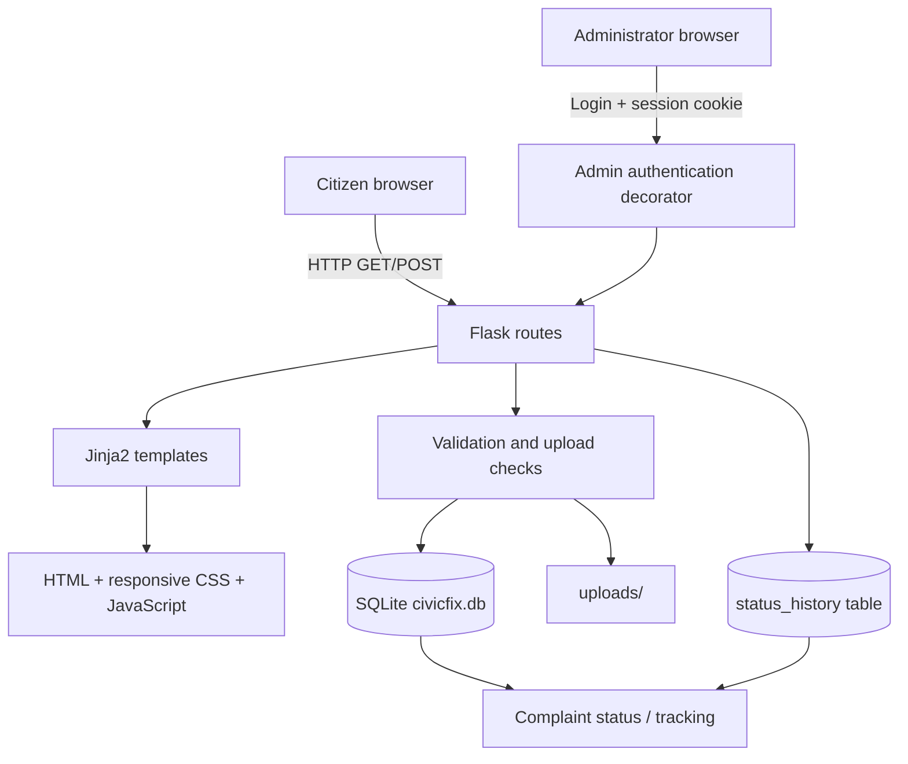

# CivicFix architecture

## Request flow
1. The browser requests a Flask route.
2. Flask validates form fields and CSRF token on POST requests.
3. Complaint data is stored with parameterized SQLite statements.
4. Images are decoded with Pillow, assigned random UUID filenames and stored in `uploads/`.
5. Admin routes require a valid signed Flask session.
6. Status changes update the report and append an audit row to `status_history` in one database transaction.
7. The public tracking page reads the complaint and its status history.

## Data model
- `reports`: current complaint data, current status, created and updated timestamps.
- `status_history`: append-only record of status transitions with UTC timestamps.

## Security notes
CSRF tokens protect state-changing form submissions. Session cookies are HttpOnly and SameSite=Lax. Uploaded images are checked by decoding their contents rather than trusting only browser-supplied MIME types. The app still needs production deployment controls and non-guessable tracking credentials before real public use.

## AI category suggestion
The report form sends the typed description to the local Flask endpoint `/api/suggest-category`.
A scikit-learn Pipeline applies TF-IDF word/bigram features and Logistic Regression to a small
built-in educational dataset. The result is only a suggestion; the citizen retains control of
the category. This is not a production-grade classifier until it is trained and evaluated on
a larger, reviewed local dataset.
